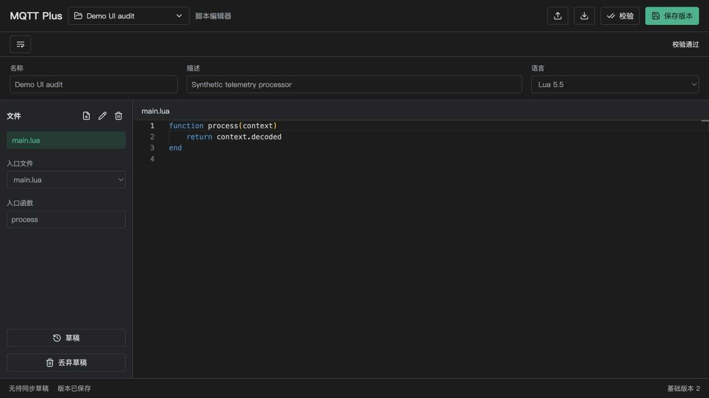
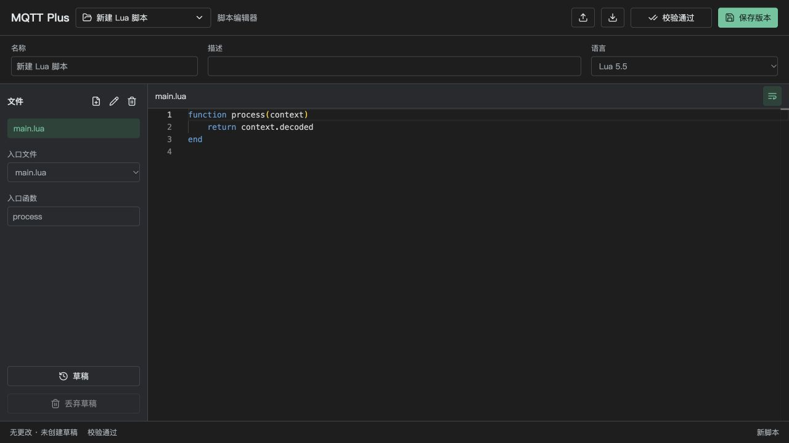
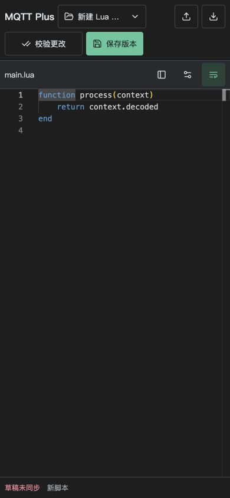
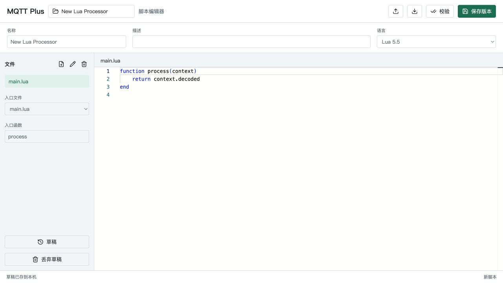
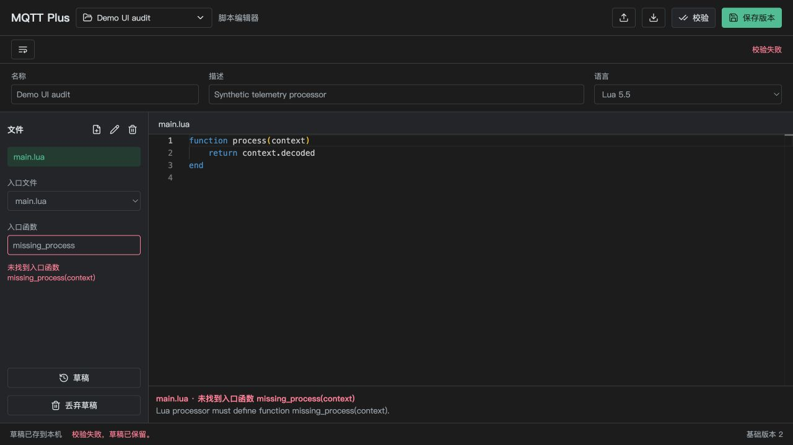
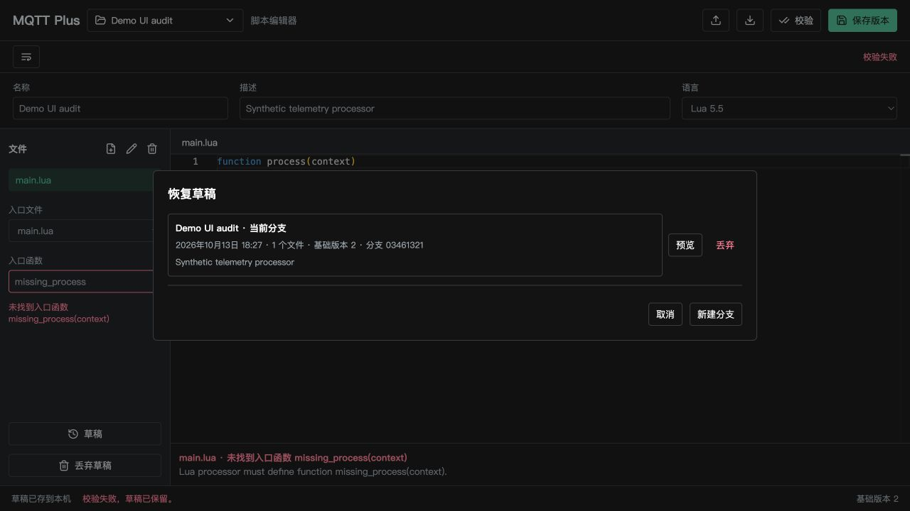
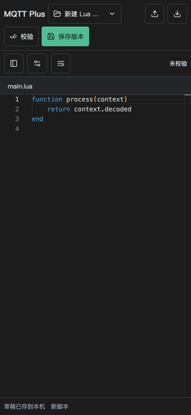
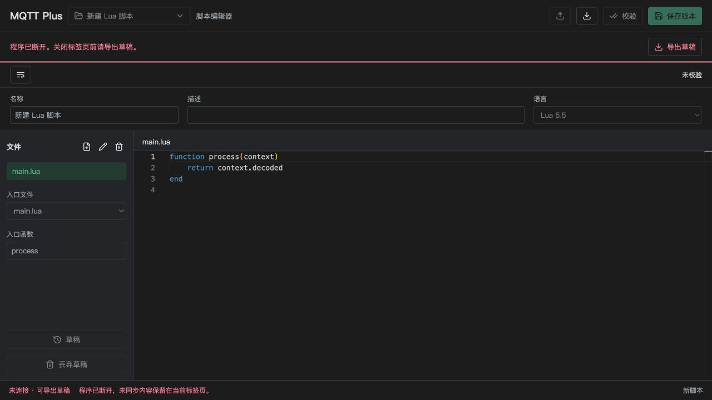

# 浏览器脚本编辑器 UI/UX 改进

## 工具栏精简补充

2026-10-13：删除单独的换行/校验状态行。换行按钮并入文件标题栏，窄屏下文件/入口和元数据展开按钮也放在这里；校验进行中、通过、失败以及修改后的待校验状态由顶部校验按钮本身呈现。桌面校验按钮预留固定最小宽度，避免状态变化挤动其他动作。

当前构建的内置浏览器验证：1280 × 720 和 390 × 844 截图、自动换行切换、窄屏文件面板展开/选择后收起、元数据展开/收起、校验通过、修改后状态更新及校验失败通过。前端 16 项、Qt 45 项、Debug 构建及 QML lint 通过；未新增跨浏览器或屏幕阅读器合规声明。前一轮独立工具栏截图保留为历史证据。

精简前（上一轮界面）：

精简后：

窄屏：

日期：2026-10-13（Asia/Shanghai）。本次保留已有布局、配色、Monaco 和版本/草稿协议，未改变正常 MQTT 执行路径。

## 修改

- 断连与授权失效显示持续横幅，直接提供导出入口；最新行为为检测后锁定代码与元数据只读，禁用文件修改及依赖服务的动作，保留查看、复制和导出。同一服务重新可用后，下一次心跳确认连接、解锁并重试断连前未同步的草稿。
- 草稿同步、校验状态和基础版本分别显示；修改后原校验结果标记为待重新校验，不把旧结果展示为当前结果。
- 草稿列表展示本地时间、当前分支、分支标识、文件数、基础版本、描述或入口信息。新增只读源码预览；恢复时重新读取最新数据，丢弃分支增加明确确认。
- 缺失入口函数显示中文摘要及原始运行时详情，入口函数字段标记错误；点击诊断将焦点移到字段。
- 脚本切换增加下拉指示，列表增加描述和版本；弹窗关联标题，预览返回后恢复焦点。
- 窄屏默认折叠文件/入口和元数据面板，代码区全宽；增加面板展开按钮和自动换行切换。小屏表单字号为 16px。
- 新脚本默认名称按界面语言生成。已有草稿和正式脚本名称不会被重命名。
- 草稿摘要增加 `fileCount`，仍不返回源码或 manifest；不修改存储 schema。

## 验证

环境：macOS arm64、Qt 6.11.1 Debug、Codex 内置浏览器、隔离临时数据库。

| 项目 | 结果 |
| --- | --- |
| 前端测试 | 11 项通过，包括时间本地化、入口诊断分类及既有保存/恢复保护 |
| 前端类型检查及生产构建 | 通过，既有 Monaco 大包体警告保留 |
| Debug 应用构建 | 通过 |
| 全部 Qt 测试 | 45 项通过 |
| QML lint | 通过 |
| 真实浏览器保存与校验 | 名称/描述修改、校验、版本保存、同步/版本/校验状态分别显示通过 |
| 错误恢复 | 缺失入口函数中文摘要、字段关联及点击后焦点跳转通过；修改后旧诊断清除并标记更改待校验 |
| 草稿列表与预览 | 摘要、当前分支、本地时间、源码预览、返回及返回焦点通过 |
| 脚本选择 | 描述/版本显示、搜索初始焦点、Escape 关闭通过 |
| 窄屏布局 | 390 × 844 默认全宽代码区、面板折叠截图通过；记录时根页面无横向溢出。展开布局和换行切换在早期验证中可见，完整窄屏键盘流程仍待人工复核 |
| 断连 | 停止服务后心跳显示横幅、导出入口和服务动作禁用；源码仍可见 |

新增分支丢弃的浏览器原生确认框阻塞了该次自动化输入，未执行删除，也未将删除确认、断连导出下载或预览后恢复执行宣布为通过。后续用新的隔离宿主检查窄屏默认布局与断连状态。重新连接、原生确认框、完整窄屏按钮/键盘操作及 JSON 下载仍需在系统浏览器人工验证；这不等于跨平台安装包验收。未进行屏幕阅读器、200% 缩放、IME 或性能验收。

## 截图

截图仅含虚构演示数据，无需脱敏；隐私和元数据检查见 [截图规范](images/README.md)。临时服务均已退出。

修改前（系统浅色主题）：

修改后（系统深色主题；用于布局与状态对比，不是同主题逐像素比较）：

字段级错误：

草稿摘要：

窄屏全宽代码区：

断连保护：

